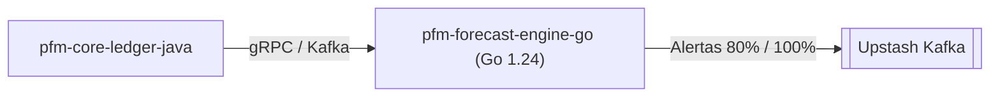

# PFM Forecast Engine Service — Golang 1.24 (Projeção & Alertas)

[](CONTRIBUTING.md)
[](CHANGELOG.md)
[](https://sorobanerp.github.io/pfm-docs/)

---

## 1. Visão Geral & Papel na Arquitetura

Motor preditivo de fluxo de caixa em **Golang 1.24+**: simulação de liquidez futura (30, 60 e 90 dias), cálculo de *burn rate* de orçamento (**RN01/RN02**) e emissão de alertas em 80% e 100% do teto.

- **Repositório:** `Sorobanerp/pfm-forecast-engine-go`
- **Vínculo com `pfm-docs`:** `ADR-001, ADR-003, ADR-005 | US-05, UC-05, UC-06`



---

## 2. Pré-requisitos & Variáveis de Ambiente

### Pré-requisitos
- Go `1.24+`
- `golangci-lint` e `gosec`

### Variáveis de Ambiente (Sem Segredos Hardcoded)
| Variável | Padrão Local | Descrição |
| :--- | :---: | :--- |
| `GRPC_PORT` | `18110` | Porta gRPC & Health HTTP do Forecast Engine |
| `KAFKA_BROKERS` | `localhost:19092` | Endereço dos brokers Kafka |

> **Segurança (Zero-Trust):** Nunca commite tokens, senhas, chaves AWS ou strings de conexão com credenciais reais. Utilize `.env` local (ignorado no `.gitignore`) ou AWS Secrets Manager / GitHub OIDC.

---

## 3. Como Executar Localmente

```bash
export GRPC_PORT=18110
go run ./cmd/...
# Healthcheck: curl -f http://localhost:18110/health
```

---

## 4. Como Testar e Validar

```bash
go test -v -race -coverprofile=coverage.out ./...
go tool cover -func=coverage.out
```

---

## 5. Como Provisionar / Validar na Nuvem

1. Fluxo Gitflow: `feat/*` $\rightarrow$ `develop` $\rightarrow$ `release/vX.Y.Z` $\rightarrow$ `main`.
2. Implantação contínua via imagem OCI Distroless Arm64 no ECS Fargate Spot (`pfm-forecast-engine-infra`).

Consulte [CONTRIBUTING.md](CONTRIBUTING.md) para regras de Conventional Commits e [CHANGELOG.md](CHANGELOG.md) para histórico de versões.
